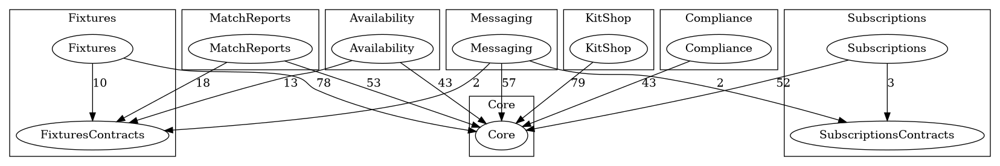

# Laravel Modular Monolith Playground

A Laravel 13 and Vue 3 app for grassroots sports clubs, where feature modules switch on or off per club and can be deleted from the codebase without breaking anything, with the boundaries enforced by Deptrac, Pest and ESLint.

[](https://github.com/phoenix1331/laravel-modular-monolith-playground/actions/workflows/ci.yml)

**Read the illustrated guide: [phoenix1331.github.io/laravel-modular-monolith-playground](https://phoenix1331.github.io/laravel-modular-monolith-playground/)**, including an interactive "installed vs enabled" demo and a step-by-step walkthrough of adding a module.

## What this demonstrates

Most "modular monolith" examples stop at folder structure. Folders are a suggestion; the first deadline turns them into a big ball of mud. This repository is about the parts that keep modules separate after the tutorial ends:

| Idea                                 | How it shows up here                                                                                                              |
| ------------------------------------ | --------------------------------------------------------------------------------------------------------------------------------- |
| **Core knows nothing about modules** | `app/` never imports a module class. Core reads class names from `config/modules.php` and nothing else                            |
| **Installed is not enabled**         | Installing is a line in a config file. Enabling is a per-club Pennant flag the super admin toggles. A disabled module returns 404 |
| **Contracts vs internals**           | Each module's `Contracts/` folder (interfaces, DTOs, events) is public; everything else is private to it                          |
| **Boundaries fail the build**        | Deptrac checks PHP layers, Pest arch tests scan for leaks Deptrac cannot see, `eslint-plugin-boundaries` does the same for Vue    |
| **Hard vs soft dependencies**        | Availability cannot exist without Fixtures. Kit Shop uses Subscriptions when it is there and works fine when it is not            |
| **Detachable, and proven**           | `make uninstall-check MODULE=Messaging` deletes the module in a temp copy and runs every gate. CI does it for every module        |

The domain is deliberately ordinary: clubs, teams, players, fixtures, subs, kit and safeguarding certificates. The interesting part is that a Sunday league side can run on fixtures alone while a youth academy switches everything on, from one codebase.

## Tech stack

| Layer         | Choice                                                                                         |
| ------------- | ---------------------------------------------------------------------------------------------- |
| Framework     | Laravel 13, PHP 8.4                                                                            |
| Frontend      | Vue 3, TypeScript, Inertia 3, Tailwind 4 (Laravel Vue starter kit), Wayfinder for typed routes |
| Runtime       | Docker, FrankenPHP, MySQL 8.4                                                                  |
| Feature flags | Laravel Pennant, database driver, scoped to the organisation                                   |
| Boundaries    | Deptrac 4, Pest arch tests, ESLint + `eslint-plugin-boundaries`                                |
| Quality       | Pest 5, Vitest, Playwright, Larastan, vue-tsc, Pint, Oxlint via vite-plus                      |
| Tenancy       | Single database, `organisation_id` plus a global scope                                         |

## Getting started

### Prerequisites

- **Docker** with Compose
- **Node.js and npm** on the host. Run `npm install` once after cloning: it activates the Husky git hooks
- **PHP 8.3+** on the host, for the pre-commit hook's Pint check
- **osv-scanner**, used by the pre-commit hook to audit `composer.lock`: `go install github.com/google/osv-scanner/cmd/osv-scanner@latest`
- Free ports **8000** (app), **5173** (Vite) and **3307** (MySQL). Change `APP_PORT`, `VITE_PORT` or `FORWARD_DB_PORT` in `.env` if any are taken

For Claude Code, `.mcp.json` configures four MCP servers:

- **GitHub** authenticates with `gh auth token`: run `gh auth login` once on each machine
- **MySQL** reads `MYSQL_HOST`, `MYSQL_PORT`, `MYSQL_USER`, `MYSQL_PASSWORD` and `MYSQL_DATABASE` from your shell, defaulting to this project's Compose service (`127.0.0.1:3307`, user `laravel`, password `secret`, database `modular_monolith`). Export them if you changed the ports or credentials
- **Playwright** and **Context7** need nothing beyond `npx`

### Run it

1. `make setup` creates `.env`, builds and starts the stack, generates the app key, migrates and seeds. About a minute on a first run
2. Open [http://localhost:8000](http://localhost:8000) and log in as `admin@riverside.test` / `password`
3. `make dev` follows the app's output (web server, queue worker, logs and Vite, all from `php artisan dev`)
4. `make check` runs every quality gate: Pint, Oxlint, ESLint boundaries, PHPStan, Deptrac, vue-tsc, Vitest and Pest
5. `make e2e` signs in as each club in a real browser and checks their menus
6. `make uninstall-check MODULE=Messaging` proves a module can be deleted
7. `make graph` redraws `docs/modules.png` from the code

`make help` lists everything else. Every PHP, Composer and npm command runs inside the app container.

## Seeded logins

Every password is `password`. `make fresh` rebuilds the same data each time.

| Club                         | Admin                  | Workers                   | Modules enabled                       |
| ---------------------------- | ---------------------- | ------------------------- | ------------------------------------- |
| Riverside Juniors FC         | `admin@riverside.test` | `coach1-3@riverside.test` | All seven                             |
| Dockside Rovers              | `admin@dockside.test`  | `coach1-2@dockside.test`  | Fixtures, Availability, Match Reports |
| Hillcrest Ladies             | `admin@hillcrest.test` | `coach1-2@hillcrest.test` | Fixtures, Subscriptions               |
| Valley Vets Walking Football | `admin@valley.test`    | `coach1-2@valley.test`    | None: Core only                       |

`super@platform.test` is the super admin. They belong to no club and switch modules on and off per club, with the reason shown when a toggle is blocked.

Worth trying: compare the menus for Riverside and Hillcrest, then sign in as the super admin and try to switch Availability on for Valley Vets (it needs Fixtures first). `coach3@riverside.test` has an expired safeguarding certificate, and Riverside's noticeboard shows announcements that Fixtures and Subscriptions produced through events.

## Environment variables

`.env.example` holds Laravel's usual keys. These are the ones this project uses or changes:

| Key                                                 | Default              | Purpose                                                                  |
| --------------------------------------------------- | -------------------- | ------------------------------------------------------------------------ |
| `APP_PORT`                                          | `8000`               | Host port for the app                                                    |
| `VITE_PORT`                                         | `5173`               | Host port for the Vite dev server                                        |
| `FORWARD_DB_PORT`                                   | `3307`               | Host port for MySQL (3306 is often taken)                                |
| `DB_HOST`                                           | `mysql`              | The Compose service name                                                 |
| `DB_DATABASE`                                       | `modular_monolith`   |                                                                          |
| `DB_USERNAME` / `DB_PASSWORD`                       | `laravel` / `secret` | Also used to create the MySQL container's user                           |
| `APP_FAKER_LOCALE`                                  | `en_GB`              | UK names and postcodes in seed data                                      |
| `SESSION_DRIVER`, `QUEUE_CONNECTION`, `CACHE_STORE` | `database`           | No Redis needed                                                          |
| `MAIL_MAILER`                                       | `log`                | Mail goes to the log                                                     |
| `UID` / `GID`                                       | `1000`               | Optional. The user the containers run as, so files they write stay yours |

## Endpoints and request.http

`request.http` works in VS Code REST Client and JetBrains HTTP Client. Routes are web routes behind CSRF, so start with "Fetch the login page" and copy the `XSRF-TOKEN` cookie into `@xsrf`. The client then keeps the session cookie between requests.

| Section                               | Shows                                                                                          |
| ------------------------------------- | ---------------------------------------------------------------------------------------------- |
| Authentication, Role areas            | Signing in, and what each role is refused                                                      |
| Teams, Players                        | Core CRUD, scoped to the signed-in user's club                                                 |
| Audit log                             | Club admins read their own club's trail                                                        |
| Platform (super admin)                | Organisation list and per-club module toggles, including blocked toggles                       |
| Fixtures, Availability, Match Reports | Module routes: 404 unless enabled for the club, hard dependencies on Fixtures                  |
| Subscriptions, Kit Shop               | The soft dependency: Kit Shop refuses orders for unpaid members only while Subscriptions is on |
| Compliance, Messaging                 | Certificates, and announcements produced by other modules' events                              |

## Architecture notes

### Installed vs enabled

Two questions, kept in two places.

**Installed** means the module's code is part of this deployment. `config/modules.php` lists each module's definition class. At boot, `ModuleRegistry` reads that list, checks it (unknown classes, duplicate keys, missing hard dependencies and cycles all stop the app with a clear message) and registers each module's service provider, routes and migrations, dependencies first. Remove the line and none of that happens.

**Enabled** means a particular club can use it. That is a Pennant flag, `module:{key}`, scoped to the organisation and changed only through `ModuleManager`, which refuses to enable a module before its hard dependencies or disable one that others need. Every module route gets a `module:{key}` middleware from the base provider, so a club without the module gets a **404**: it should look like the module does not exist, not like access was denied. The Vue menu is built from the same list. Switching a module off only flips the flag, so its data is still there when it comes back on.

### Deptrac layers

Every module gets two Deptrac layers: `{Name}` for its internals and `{Name}Contracts` for its public folder. The ruleset says which layers each one may use:

```yaml
Availability:
    - Core
    - Framework
    - AvailabilityContracts
    - FixturesContracts # its hard dependency, through the public surface only

Core:
    - Framework # Core may not name any module layer
```

Change `FixturesContracts` to `Fixtures` and the app still runs: that one line is the boundary, and `make deptrac` is what holds it. It runs with `--fail-on-uncovered` and `debug:unassigned`, so a class outside every layer fails too. Pest arch tests cover what Deptrac cannot: no raw `DB::table()` queries (they skip the tenancy scope), no queries built in controllers, and no services resolved by string key. Tables are prefixed with the module key, and there are no foreign keys between modules: Availability stores a fixture id and resolves it through `FixtureLookup`.



### Hard vs soft dependencies

|                          | Hard                               | Soft                                     |
| ------------------------ | ---------------------------------- | ---------------------------------------- |
| Example                  | Availability needs Fixtures        | Kit Shop uses Subscriptions when present |
| Declared                 | `hardDependencies(): ['fixtures']` | `softDependencies(): ['subscriptions']`  |
| Enabling                 | Blocked until the dependency is on | Never blocked                            |
| Other module uninstalled | App refuses to boot, naming both   | Keeps working with a default             |
| Code talks through       | The dependency's `Contracts/`      | A Core capability, or events             |

A soft dependency through a **capability**: `App\Capabilities\MembershipStatus` lives in Core with a null implementation (everyone is paid up). While Subscriptions is installed its provider rebinds it, and on every resolve answers for real only if the current club has Subscriptions enabled. Kit Shop asks the same question either way and never imports Subscriptions; on the graph above it has no edge to Subscriptions at all.

A soft dependency through **events**: Fixtures and Subscriptions publish `FixtureScheduled` and `PaymentOverdue` from their `Contracts/`. Messaging listens only to modules that are installed, and its listeners do nothing for clubs without Messaging.

### The frontend follows the same rules

Each module's Vue code lives in `resources/js/modules/{key}/`, and its `index.ts` is the only file anything else may import. The menu is built by globbing those files, so Core's code never names a module. `eslint.config.js` enforces it, including Wayfinder's generated route helpers, which count as part of the module that owns them.

### Proving it

"Deletable" is a claim, so it is tested. `make uninstall-check MODULE={Name}` copies the project, removes the module from `config/modules.php`, deletes its PHP and Vue folders, and runs Pest, Deptrac, ESLint, vue-tsc and Vitest against what is left. CI runs it for every module that can stand alone (not Fixtures, which others hard-depend on). The first run found a real leak: Kit Shop's tests assumed Subscriptions existed. Module tests now live inside each module, skip when a soft dependency is missing, and disappear with the folder.

## Build your own module

One command scaffolds a module that works straight away: a gated page, its menu link, a test, Deptrac layers, the config entry and a CI uninstall check.

```bash
make artisan cmd="make:module Training --hard=fixtures --soft=subscriptions"
make check
make uninstall-check MODULE=Training
```

Then sign in as `super@platform.test` and enable Training for a club. To build one by hand, or to see why each generated piece exists:

1. `modules/{Name}/{Name}Module.php`: key, name and dependencies by key
2. `modules/{Name}/{Name}ServiceProvider.php`: extends `ModuleServiceProvider`, which loads routes and migrations behind `module:{key}`
3. Migrations, models with `BelongsToOrganisation`, routes, controllers and `Queries/` classes inside the module
4. Add the definition to `config/modules.php`
5. Two layers, a ruleset entry and a graph group in `deptrac.yaml`
6. `resources/js/modules/{key}/index.ts` with `defineModule()`, and pages in `pages/`
7. Tests in `modules/{Name}/Tests`, and a seeder returned from `seeder()` if you want demo data

The full walkthrough is on the guide's [Add a module](https://phoenix1331.github.io/laravel-modular-monolith-playground/add-a-module.html) page, and `modules/README.md` lists every rule alongside the tool that enforces it. `modules/Fixtures` is the annotated reference module; `modules/Compliance` is the smallest complete one.
